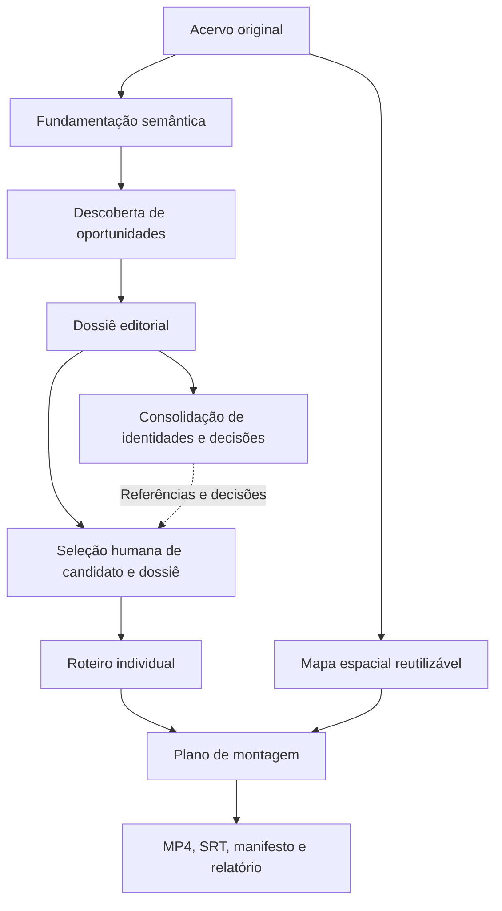

# Class_Material

Acervo de materiais didáticos de programação e computação, organizado em módulos temáticos. Reúne imagens PNG e JPEG, animações GIF e documentos Markdown, incluindo exercícios e gabaritos, além de arquivos-fonte em C e catálogos semânticos em DOCX.

## Visão geral da arquitetura

Além do acervo, o projeto reúne uma infraestrutura documental de curadoria e produção editorial para transformar conhecimento documentado em propostas de conteúdo audiovisual. O fluxo separa fundamentação, escolhas editoriais, preparação visual e execução técnica:

Cada etapa depende do escopo autorizado; as setas não representam execução automática nem aprovação editorial.

### Arquitetura semântica

| Fonte | Responsabilidade |
|---|---|
| [inventario.csv](inventario.csv) | Localizar materiais e catálogos pelos nomes exatos e pelo módulo. |
| Catálogos semânticos por capítulo, na tabela de módulos abaixo | Descrever conteúdos, representações, exemplos e conceitos dos materiais. |
| [Vocabulário controlado](curadoria/vocabulario_controlado.md) | Consolidar termos canônicos, definições e associações ao acervo. |
| [Relacionamentos conceituais](curadoria/relacionamentos_conceituais.md) | Oferecer vínculos auxiliares entre capítulos, com evidências, decisões e ressalvas. |

Os originais fornecem o conteúdo visual real; as descrições documentais fundamentam a descoberta editorial, mas não comprovam correção ou inspeção visual. Os catálogos e o vocabulário são referências primárias para conteúdos e conceitos; o mapa de relacionamentos não impõe uma sequência curricular.

### Arquitetura editorial

O [protocolo de roteirização](curadoria/protocolo_roteirizacao.md) orienta a descoberta de oportunidades com pergunta, problema, contraste, surpresa ou aplicação próprios. Não há correspondência obrigatória entre capítulo, conceito e vídeo: conceitos podem ser combinados, desdobrados em narrativas distintas ou usados apenas como apoio. Não se pretende esgotar cada capítulo em vídeos, mas identificar as oportunidades audiovisuais que ele oferece, sem quantidade esperada de candidatos.

O dossiê em [editorial/dossies](editorial/dossies/) desenvolve candidatos com justificativa de autonomia, hooks, narrativas preliminares faláveis e storyboards. As propostas são comparadas quanto às diferenças, sobreposições e possíveis combinações, com precisão pedagógica acima do apelo de abertura.

O [protocolo de consolidação editorial](curadoria/protocolo_consolidacao_editorial.md) define uma camada para organizar identidades, alternativas, sobreposições e decisões entre dossiês, sem reescrever suas propostas ou criar conteúdo narrativo. Os registros previstos em `editorial/consolidacoes/NN_Consolidacao_Editorial.md` são catálogos de decisões e referências; a definição do contrato não significa que esses catálogos já tenham sido produzidos.

A seleção humana determina qual candidato-fonte, em qual dossiê, segue para o [roteiro individual pré-edição](curadoria/protocolo_roteiro_individual.md), em [editorial/roteiros](editorial/roteiros/). O padrão é o dossiê canônico do capítulo, mas a autorização pode selecionar explicitamente outro dossiê existente. O roteiro desenvolve falas, takes e tempos indicativos exclusivamente a partir desse candidato no dossiê selecionado; a consolidação não fornece conteúdo adicional. Homologar um relacionamento, aprovar uma oportunidade e autorizar um roteiro são decisões distintas. Essa camada não altera o caminho independente do mapeamento espacial nem a arquitetura de produção audiovisual.

### Mapeamento espacial e produção audiovisual

O [mapeamento espacial](curadoria/protocolo_mapeamento_espacial.md) inspeciona os originais e registra regiões completas, IDs e coordenadas em `NN_Mapa_Espacial.json`, com projeções 9:16 e autoauditoria. O mapa é um acervo visual reutilizável, não um storyboard ou sequência obrigatória.

Roteiro e mapa convergem no [plano de montagem](curadoria/protocolo_montagem_audiovisual.md), em [editorial/montagens](editorial/montagens/). Sua execução autorizada pode produzir MP4, SRT conforme a modalidade, manifesto e relatório, seguindo o [contrato de entrega](curadoria/contrato_entrega_video.md) e a [revisão audiovisual](curadoria/protocolo_revisao_audiovisual.md). Arquivos de projeto e evidências ficam em [videos](videos/). MP4 e áudios permanecem fora do Git, em `/workspace/artifacts/<ID_VIDEO>/`; a entrega usa link direto ao MP4 no visualizador do workspace e **Salvar vídeo como...** no navegador, sem presumir persistência após o encerramento do ambiente.

### Retroalimentação e controle de qualidade

O [protocolo de retroalimentação](curadoria/protocolo_retroalimentacao.md) distingue divergência documental (D), problema pedagógico ou do original (P), ressalva visual prevista (V) e defeito geométrico (G). Ocorrências e decisões são registradas no [checklist](curadoria/checklist.md); a correção retorna à camada responsável e preserva originais e derivados válidos. A revalidação se concentra nos derivados efetivamente afetados.

Os pilotos já utilizam inspeção, registro de ocorrências e conferência de hashes. **Correção automática de imagens e rastreamento incremental automático de dependências por hashes permanecem capacidades futuras**, não funcionalidades implementadas. A presença de hashes não equivale a um sistema automático de propagação de mudanças.

### Autonomia e governança

As [instruções operacionais](AGENTS.md) delimitam a atuação dos agentes: pesquisa documental, elaboração, validações técnicas e execução de tarefas autorizadas, incluindo commit, push e abertura de PR. O responsável humano decide sobre escolhas editoriais, correções pedagógicas e integração das PRs. Aprovação técnica de MP4, aprovação de PR e homologação editorial são decisões distintas; não há merge automático.

### Estado atual: piloto V03-003

O capítulo 03 possui [dossiê](editorial/dossies/03_Dossie_Editorial.docx), [roteiro V03-003 — NOT precisa de uma largura](editorial/roteiros/03-003_Roteiro_Individual.docx), [mapa espacial](03_Operacoes_Bitwise/03_Mapa_Espacial.json) e [plano de montagem](editorial/montagens/03-003_Montagem.json) integrados. O [manifesto](videos/V03-003/V03-003_Manifesto.json), o [relatório](videos/V03-003/V03-003_Relatorio.md) e as [evidências de validação](videos/V03-003/evidencias/validacao.json) documentam renderização experimental com voz de referência, SRT provisório e verificações técnicas.

A execução permanece registrada como `PENDENTE_REVISAO`: escuta perceptiva e sincronismo fino dependem de revisão humana. Esses artefatos demonstram a continuidade do fluxo, sem afirmar publicação externa ou homologação editorial. O MP4 não é versionado; sua disponibilidade está vinculada ao workspace de execução.

## Organização

Cada diretório abaixo corresponde a um módulo. Seus materiais originais estão armazenados diretamente na respectiva pasta; capítulos já mapeados também podem conter JSON espacial e um subdiretório de evidências derivadas.

| Diretório | Assunto | Catálogo semântico |
|---|---|---|
| [01_Logica_e_Raciocinio](01_Logica_e_Raciocinio/) | Lógica e raciocínio | [01_Catalogo_Semantico.docx](01_Logica_e_Raciocinio/01_Catalogo_Semantico.docx) |
| [02_Sistemas_de_Numeracao](02_Sistemas_de_Numeracao/) | Sistemas de numeração | [02_Catalogo_Semantico.docx](02_Sistemas_de_Numeracao/02_Catalogo_Semantico.docx) |
| [03_Operacoes_Bitwise](03_Operacoes_Bitwise/) | Operações bitwise | [03_Catalogo_Semantico.docx](03_Operacoes_Bitwise/03_Catalogo_Semantico.docx) |
| [04_Argumentos_CommandLine](04_Argumentos_CommandLine/) | Argumentos de linha de comando e variáveis de ambiente em C | [04_Catalogo_Semantico.docx](04_Argumentos_CommandLine/04_Catalogo_Semantico.docx) |
| [05_Estruturas_de_Dados](05_Estruturas_de_Dados/) | Estruturas de dados | [05_Catalogo_Semantico.docx](05_Estruturas_de_Dados/05_Catalogo_Semantico.docx) |
| [06_Arquivos_e_Entrada_Saida](06_Arquivos_e_Entrada_Saida/) | Arquivos e entrada/saída | [06_Catalogo_Semantico.docx](06_Arquivos_e_Entrada_Saida/06_Catalogo_Semantico.docx) |
| [07_Tracing_e_Execucao](07_Tracing_e_Execucao/) | Tracing e execução | [07_Catalogo_Semantico.docx](07_Tracing_e_Execucao/07_Catalogo_Semantico.docx) |
| [08_Tipos_e_Memoria_C](08_Tipos_e_Memoria_C/) | Tipos e memória em C | [08_Catalogo_Semantico.docx](08_Tipos_e_Memoria_C/08_Catalogo_Semantico.docx) |
| [09_Depuracao_C](09_Depuracao_C/) | Depuração em C | [09_Catalogo_Semantico.docx](09_Depuracao_C/09_Catalogo_Semantico.docx) |
| [10_Estruturas_Controle](10_Estruturas_Controle/) | Estruturas de controle | [10_Catalogo_Semantico.docx](10_Estruturas_Controle/10_Catalogo_Semantico.docx) |
| [11_Sistemas_Operacionais](11_Sistemas_Operacionais/) | Sistemas operacionais em C — Linux/POSIX | [11_Catalogo_Semantico.docx](11_Sistemas_Operacionais/11_Catalogo_Semantico.docx) |
| [12_Organizacao_Computadores](12_Organizacao_Computadores/) | Organização de computadores e projeto de circuitos digitais | [12_Catalogo_Semantico.docx](12_Organizacao_Computadores/12_Catalogo_Semantico.docx) |

A numeração dos módulos organiza os assuntos, mas não estabelece necessariamente uma sequência obrigatória de estudo. A numeração nos nomes dos arquivos também não deve ser tomada, por si só, como uma ordem de leitura.

## Localização dos materiais

Consulte [inventario.csv](inventario.csv), o índice dos 255 materiais e documentos de referência do acervo: 243 materiais didáticos e 12 catálogos semânticos. O arquivo utiliza o separador `;` e as colunas `modulo` e `arquivo`. Para localizar um material a partir da raiz do repositório, combine os valores como `modulo/arquivo`.

As entradas estão ordenadas por módulo e, dentro de cada módulo, por nome de arquivo. O índice inclui imagens, GIFs, documentos Markdown, arquivos-fonte em C e os catálogos DOCX, cada um associado ao seu módulo. Os catálogos são documentos de referência, distintos dos materiais que descrevem. Não inclui mapas espaciais e suas evidências derivadas, documentos editoriais, artefatos de produção, documentos de governança da raiz e de `curadoria/`, o próprio inventário nem este README.

## Catálogos semânticos

Cada módulo possui um documento `NN_Catalogo_Semantico.docx`, acessível na tabela acima. Esses catálogos são a fonte documental de referência para a interpretação semântica do acervo: identificam os materiais pelo nome de arquivo, descrevem conteúdos, representações, exemplos e transições relevantes dos GIFs e associam palavras-chave a cada registro. O glossário do capítulo reúne definições e um índice reverso dos materiais relacionados.

Para consultar o acervo, localize o arquivo no inventário e leia seu registro no catálogo do módulo correspondente. Relacione documento e material físico pelo nome exato do arquivo. O catálogo não substitui o original nem comprova sua integridade, correção ou validação visual; informações não descritas não devem ser presumidas. Divergências entre catálogo e arquivos devem ser relatadas separadamente.

O vocabulário controlado é cumulativo: reutilize a nomenclatura já estabelecida para o mesmo conceito, como `ponteiro`, sem introduzir `pointer` ou `apontador` como etiquetas alternativas. Conceitos distintos permanecem separados. Divergências de termos devem ser submetidas à avaliação, sem unificação automática ou edição dos catálogos.

## Exercícios e gabaritos

Os links abaixo apontam para os enunciados e seus respectivos gabaritos. Os nomes dos arquivos variam entre módulos; no módulo 04 há dois pares numerados, no módulo 05 há três, e no módulo 11 o gabarito inclui orientações e arquivos-fonte separados.

| Módulo | Exercício | Gabarito |
|---|---|---|
| 01 - Lógica e raciocínio | [exercicio.md](01_Logica_e_Raciocinio/exercicio.md) | [gabarito.md](01_Logica_e_Raciocinio/gabarito.md) |
| 02 - Sistemas de numeração | [exercicio.md](02_Sistemas_de_Numeracao/exercicio.md) | [gabarito.md](02_Sistemas_de_Numeracao/gabarito.md) |
| 03 - Operações bitwise | [exercicio.md](03_Operacoes_Bitwise/exercicio.md) | [gabarito.md](03_Operacoes_Bitwise/gabarito.md) |
| 04 - Argumentos de linha de comando e variáveis de ambiente em C | [1 — Calculadora parametrizável](04_Argumentos_CommandLine/exercicio1.md) | [gabarito1.md](04_Argumentos_CommandLine/gabarito1.md) |
| 04 - Argumentos de linha de comando e variáveis de ambiente em C | [2 — Evolução da calculadora parametrizável](04_Argumentos_CommandLine/exercicio2.md) | [gabarito2.md](04_Argumentos_CommandLine/gabarito2.md) |
| 05 - Estruturas de dados | [A — Lista simplesmente encadeada](05_Estruturas_de_Dados/exercicio1.md) | [gabarito1.md](05_Estruturas_de_Dados/gabarito1.md) |
| 05 - Estruturas de dados | [B — Fila de atendimento drive-thru](05_Estruturas_de_Dados/exercicio2.md) | [gabarito2.md](05_Estruturas_de_Dados/gabarito2.md) |
| 05 - Estruturas de dados | [C — Calculadora com pilha de desfazimento](05_Estruturas_de_Dados/exercicio3.md) | [gabarito3.md](05_Estruturas_de_Dados/gabarito3.md) |
| 06 - Arquivos e entrada/saída | [Explorador de arquivos em C](06_Arquivos_e_Entrada_Saida/exercicio.md) | [gabarito.md](06_Arquivos_e_Entrada_Saida/gabarito.md) |
| 07 - Tracing e execução | [exercicio.md](07_Tracing_e_Execucao/exercicio.md) | [gabarito.md](07_Tracing_e_Execucao/gabarito.md) |
| 08 - Tipos e memória em C | [exercicio.md](08_Tipos_e_Memoria_C/exercicio.md) | [gabarito.md](08_Tipos_e_Memoria_C/gabarito.md) |
| 09 - Depuração em C | [exercicio.md](09_Depuracao_C/exercicio.md) | [gabarito.md](09_Depuracao_C/gabarito.md) |
| 10 - Estruturas de controle | [exercicio.md](10_Estruturas_Controle/exercicio.md) | [gabarito.md](10_Estruturas_Controle/gabarito.md) |
| 11 - Sistemas operacionais em C — Linux/POSIX | [Processos e comunicação entre processos](11_Sistemas_Operacionais/exercicio.md) | [Orientações](11_Sistemas_Operacionais/gabarito1.md); [código da parte A](11_Sistemas_Operacionais/gabarito1a.c); [código da parte B](11_Sistemas_Operacionais/gabarito1b.c) |
| 12 - Organização de computadores e projeto de circuitos digitais | [Projeto de um circuito digital](12_Organizacao_Computadores/exercicio1.md) | [gabarito1.md](12_Organizacao_Computadores/gabarito1.md) |

Os gabaritos podem apresentar explicações, critérios de avaliação ou implementações em C. No módulo 04, `gabarito1.md` contém a implementação em C e `gabarito2.md` reúne implementação e orientações. Todos os 12 módulos possuem ao menos um enunciado de exercício e um gabarito. Os links indicam a correspondência documental; não significam que todos os conteúdos foram submetidos à auditoria técnica e pedagógica.

## Curadoria e governança

O diretório [curadoria](curadoria/) reúne o [checklist de observações, decisões e pendências](curadoria/checklist.md). As [regras operacionais para o Codex](AGENTS.md) ficam na raiz. Esses documentos acompanham a manutenção do acervo e não são materiais didáticos indexados no CSV.

O [mapa de relacionamentos conceituais](curadoria/relacionamentos_conceituais.md) reúne 26 relações aprovadas pedagogicamente entre materiais de capítulos diferentes, três delas com ressalvas obrigatórias (RC-014, RC-023 e RC-024), preservando as evidências e classificações documentais. É uma fonte documental auxiliar: não estabelece uma trilha curricular obrigatória nem autoriza edições nos materiais. Os catálogos semânticos e o [vocabulário mestre](curadoria/vocabulario_controlado.md) continuam sendo as referências primárias para conteúdos e conceitos.
