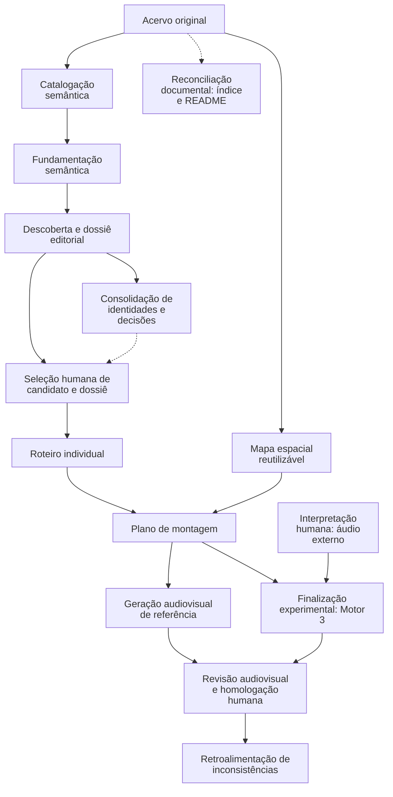

# Class_Material

Acervo de materiais didáticos de programação e computação, organizado em módulos temáticos. Reúne imagens PNG e JPEG, animações GIF e documentos Markdown, incluindo exercícios e gabaritos, além de arquivos-fonte e headers em C, pacotes ZIP de apoio e catálogos semânticos em DOCX.

<!-- reconciliacao:inicio arquitetura -->
## Visão geral da arquitetura

O fluxo distingue contratos documentais, artefatos existentes e execução experimental. As setas indicam dependências; não são aprovações nem uma sequência automática de produção. Clique nas etapas para consultar suas fontes.

### Contratos presentes e seus estados declarados

A existência de um protocolo não comprova implementação, demonstração ou homologação. Os estados abaixo são transcritos dos cabeçalhos das fontes, sem reinterpretar sua aprovação.

| Contrato | Versão declarada | Estado declarado na fonte |
|---|---|---|
| [Contrato — manutenção incremental dos catálogos semânticos](curadoria/contrato_catalogacao_incremental.md) | Não declarado no cabeçalho; consultar a fonte. | IMPLEMENTADO EM CANDIDATOS — mecanismo, testes e piloto controlado nesta PR; sujeito à revisão humana. Não autoriza alteração automática de catálogos canônicos. |
| [Contrato técnico de entrega de vídeo](curadoria/contrato_entrega_video.md) | Não declarado no cabeçalho; consultar a fonte. | proposta sujeita à homologação humana. |
| [Protocolo de catalogação semântica autônoma](curadoria/protocolo_catalogacao_semantica.md) | `0.1.1` | PROPOSTO — implementação e pilotos autorizados; protocolo e qualidade dos catálogos sujeitos à avaliação humana. |
| [Protocolo de consolidação editorial](curadoria/protocolo_consolidacao_editorial.md) | `0.1.1` — distinção entre aceitação documental e homologação editorial | PROPOSTO — sujeito à revisão e homologação humana |
| [Protocolo de Mapeamento Espacial e Autoauditoria Visual](curadoria/protocolo_mapeamento_espacial.md) | Não declarado no cabeçalho; consultar a fonte. | proposta operacional para revisão e homologação humana |
| [Protocolo de montagem audiovisual](curadoria/protocolo_montagem_audiovisual.md) | Não declarado no cabeçalho; consultar a fonte. | proposta sujeita à homologação humana. |
| [Protocolo de retroalimentação e tratamento de inconsistências](curadoria/protocolo_retroalimentacao.md) | Não declarado no cabeçalho; consultar a fonte. | protocolo operacional sujeito à homologação humana. |
| [Protocolo de revisão audiovisual](curadoria/protocolo_revisao_audiovisual.md) | Não declarado no cabeçalho; consultar a fonte. | proposta de protocolo operacional, sujeita à homologação humana. |
| [Protocolo de roteirização e leitura de dossiês](curadoria/protocolo_roteirizacao.md) | `0.3.0` — descoberta e comparação de oportunidades narrativas | PROPOSTO — evolução sujeita à homologação humana; preservadas as regras de fundamentação, desenvolvimento narrativo e integração editorial |
| [Protocolo de roteiro individual](curadoria/protocolo_roteiro_individual.md) | `0.2.0` — seleção explícita do dossiê de entrada, preservada a fonte exclusiva | PROPOSTO — sujeito à homologação humana |

### Artefatos observáveis

| Componente | Evidência física atual |
|---|---|
| Dossiês canônicos | 4 arquivos em [editorial/dossies](editorial/dossies/); presença não implica aprovação. |
| Registros de consolidação | 1 arquivo em [editorial/consolidacoes](editorial/consolidacoes/); presença não implica aprovação. |
| Roteiros individuais | 3 arquivos em [editorial/roteiros](editorial/roteiros/); presença não implica aprovação. |
| Planos de montagem | 3 arquivos em [editorial/montagens](editorial/montagens/); presença não implica aprovação. |
| Mapas espaciais | 4 mapas canônicos presentes; seleção e tempos pertencem à montagem. |

### Finalização e interpretação humana

O núcleo tem implementação presente em [videos/motor3](videos/motor3/). Áudio externo é uma entrada para finalização; a rotina documental não produz nem presume uma gravação humana. Capacidades e limitações são declarações do [laudo do Motor 3](videos/motor3/RELATORIO.md) e do README do componente, não certificações desta reconciliação.

| Capacidade | Resultado |
| --- | --- |
| Marco A: executar plano explícito | Demonstrado com dois MP4: 1.577 e 1.727 quadros; 52,566667 e 57,566667 s. Mesmas cinco regiões, um segundo adicional por take. |
| Áudio externo exclusivo | Demonstrado com o WAV **sintético anterior**, sem chamar TTS. Não é prova de gravação humana. |
| Associação e nova montagem | Fluxo completo demonstrado com dez enunciados e tempos fornecidos do SRT sintético, sem IDs de takes na transcrição. É teste controlado, não reconhecimento autônomo. |
| ASR local real | Executado com faster-whisper base; texto incorreto e uma palavra com duração zero. Finalização interrompida; transcrição preservada, sem MP4/SRT falsamente validados. |
| Gravação humana | Não fornecida; ausência confirmada pelo responsável. Marco B humano/autônomo **não concluído**. |
| Reformulação narrativa geral | Não implementada como classificador semântico geral. Equivalências documentadas são suportadas; desconhecidas ficam pendentes. |

A produção segue o [contrato de entrega](curadoria/contrato_entrega_video.md). MP4 e áudios permanecem fora do Git, no workspace; arquivos de projeto, legendas e relatórios são versionáveis. Entrega técnica não equivale à homologação editorial.

A [retroalimentação](curadoria/protocolo_retroalimentacao.md) encaminha inconsistências à camada responsável e preserva derivados válidos. Correções pedagógicas e alterações de fontes dependem de autorização específica. Esta reconciliação não implementa propagação automática de mudanças por hashes nem correção de imagens.

### Reconciliação documental

Execute `python ferramentas/reconciliar_documentacao.py` após alterações elegíveis. O modo `--check` verifica divergências sem escrever; o CI utiliza esse modo. Somente `inventario.csv` e os blocos gerados deste README são atualizados. Ambiguidades são informadas; não homologam materiais nem bloqueiam entradas independentes.

Regras, limites e testes: [instruções de execução](ferramentas/README.md). O responsável humano continua decidindo sobre a integração das PRs, as escolhas editoriais e as correções pedagógicas; não há merge automático.

### Histórico avaliativo

As [avaliações históricas](curadoria/avaliacoes/) registram investigações e pilotos. Não são protocolos vigentes, catálogos canônicos ou decisões do checklist. Sua produção não é obrigatória a cada catalogação; estados e referências de época não substituem as normas atuais.

A [manutenção incremental dos catálogos](curadoria/contrato_catalogacao_incremental.md) tem mecanismo presente em [ferramentas/catalogacao_incremental.py](ferramentas/catalogacao_incremental.py). O agente inspeciona novos/modificados e fornece fichas verificadas; a ferramenta confronta hashes, preserva fichas inalteradas e prepara DOCX candidato. Isso não é interpretação visual automática nem autorização para substituir catálogos canônicos.
<!-- reconciliacao:fim arquitetura -->

## Princípios editoriais

O [protocolo de roteirização](curadoria/protocolo_roteirizacao.md) orienta a descoberta de oportunidades com pergunta, problema, contraste, surpresa ou aplicação próprios. Não há correspondência obrigatória entre capítulo, conceito e vídeo: conceitos podem ser combinados, desdobrados em narrativas distintas ou usados apenas como apoio. Não se pretende esgotar cada capítulo em vídeos, mas identificar as oportunidades audiovisuais que ele oferece, sem quantidade esperada de candidatos.

O dossiê em [editorial/dossies](editorial/dossies/) desenvolve candidatos com justificativa de autonomia, hooks, narrativas preliminares faláveis e storyboards. As propostas são comparadas quanto às diferenças, sobreposições e possíveis combinações, com precisão pedagógica acima do apelo de abertura.

O [protocolo de consolidação editorial](curadoria/protocolo_consolidacao_editorial.md) define uma camada para organizar identidades, alternativas, sobreposições e decisões entre dossiês, sem reescrever suas propostas ou criar conteúdo narrativo. Os registros previstos em `editorial/consolidacoes/NN_Consolidacao_Editorial.md` são catálogos de decisões e referências; a disponibilidade dos registros existentes é apresentada na seção gerada de artefatos observáveis.

A seleção humana determina qual candidato-fonte, em qual dossiê, segue para o [roteiro individual pré-edição](curadoria/protocolo_roteiro_individual.md), em [editorial/roteiros](editorial/roteiros/). O padrão é o dossiê canônico do capítulo, mas a autorização pode selecionar explicitamente outro dossiê existente. O roteiro desenvolve falas, takes e tempos indicativos exclusivamente a partir desse candidato no dossiê selecionado; a consolidação não fornece conteúdo adicional. Homologar um relacionamento, aprovar uma oportunidade e autorizar um roteiro são decisões distintas. Essa camada não altera o caminho independente do mapeamento espacial nem a arquitetura de produção audiovisual.

## Registro histórico do piloto V03-003

O capítulo 03 possui [dossiê](editorial/dossies/03_Dossie_Editorial.docx), [roteiro V03-003 — NOT precisa de uma largura](editorial/roteiros/03-003_Roteiro_Individual.docx), [mapa espacial](03_Operacoes_Bitwise/03_Mapa_Espacial.json) e [plano de montagem](editorial/montagens/03-003_Montagem.json) integrados. O [manifesto](videos/V03-003/V03-003_Manifesto.json), o [relatório](videos/V03-003/V03-003_Relatorio.md) e as [evidências de validação](videos/V03-003/evidencias/validacao.json) documentam renderização experimental com voz de referência, SRT provisório e verificações técnicas.

A execução permanece registrada como `PENDENTE_REVISAO`: escuta perceptiva e sincronismo fino dependem de revisão humana. Esses artefatos demonstram a continuidade do fluxo, sem afirmar publicação externa ou homologação editorial. O MP4 não é versionado; sua disponibilidade está vinculada ao workspace de execução.

<!-- reconciliacao:inicio organizacao -->
## Organização

Diretórios de capítulos são descobertos na raiz. A identificação abaixo usa o título documental do capítulo, quando disponível, ou seu nome físico. Numeração não estabelece ordem obrigatória de estudo.

| Diretório | Identificação do capítulo | Entradas no índice | Catálogo canônico |
|---|---|---:|---|
| [01_Logica_e_Raciocinio](01_Logica_e_Raciocinio/) | Lógica e Raciocínio | 17 | [01_Catalogo_Semantico.docx](01_Logica_e_Raciocinio/01_Catalogo_Semantico.docx) |
| [02_Sistemas_de_Numeracao](02_Sistemas_de_Numeracao/) | Sistemas de Numeração | 15 | [02_Catalogo_Semantico.docx](02_Sistemas_de_Numeracao/02_Catalogo_Semantico.docx) |
| [03_Operacoes_Bitwise](03_Operacoes_Bitwise/) | Operações Bitwise | 21 | [03_Catalogo_Semantico.docx](03_Operacoes_Bitwise/03_Catalogo_Semantico.docx) |
| [04_Argumentos_CommandLine](04_Argumentos_CommandLine/) | Argumentos CommandLine | 36 | [04_Catalogo_Semantico.docx](04_Argumentos_CommandLine/04_Catalogo_Semantico.docx) |
| [05_Estruturas_de_Dados](05_Estruturas_de_Dados/) | Estruturas de Dados | 25 | [05_Catalogo_Semantico.docx](05_Estruturas_de_Dados/05_Catalogo_Semantico.docx) |
| [06_Arquivos_e_Entrada_Saida](06_Arquivos_e_Entrada_Saida/) | Arquivos e Entrada/Saída | 9 | [06_Catalogo_Semantico.docx](06_Arquivos_e_Entrada_Saida/06_Catalogo_Semantico.docx) |
| [07_Tracing_e_Execucao](07_Tracing_e_Execucao/) | Tracing e Execução | 8 | [07_Catalogo_Semantico.docx](07_Tracing_e_Execucao/07_Catalogo_Semantico.docx) |
| [08_Tipos_e_Memoria_C](08_Tipos_e_Memoria_C/) | Tipos e Memória C | 28 | [08_Catalogo_Semantico.docx](08_Tipos_e_Memoria_C/08_Catalogo_Semantico.docx) |
| [09_Depuracao_C](09_Depuracao_C/) | Depuração C | 16 | [09_Catalogo_Semantico.docx](09_Depuracao_C/09_Catalogo_Semantico.docx) |
| [10_Estruturas_Controle](10_Estruturas_Controle/) | Estruturas de Controle | 25 | [10_Catalogo_Semantico.docx](10_Estruturas_Controle/10_Catalogo_Semantico.docx) |
| [11_Sistemas_Operacionais](11_Sistemas_Operacionais/) | Sistemas Operacionais | 40 | [11_Catalogo_Semantico.docx](11_Sistemas_Operacionais/11_Catalogo_Semantico.docx) |
| [12_Organizacao_Computadores](12_Organizacao_Computadores/) | Organização de Computadores | 18 | [12_Catalogo_Semantico.docx](12_Organizacao_Computadores/12_Catalogo_Semantico.docx) |
| [13_Compilacao_Makefile](13_Compilacao_Makefile/) | Compilação e Makefile | 24 | Sem catálogo canônico |
<!-- reconciliacao:fim organizacao -->

<!-- reconciliacao:inicio inventario -->
## Localização dos materiais

O [inventario.csv](inventario.csv) contém **282 entradas** em **13 capítulos**: **270 materiais didáticos** e **12 catálogos canônicos**. O contrato é `modulo;arquivo`; combine `modulo/arquivo` para localizar o arquivo a partir da raiz. A ordenação é estável por capítulo e caminho relativo do arquivo, preservando grafia e caixa.

São elegíveis materiais PNG, JPG/JPEG, GIF, Markdown, fontes C, headers e pacotes ZIP nas áreas de materiais dos capítulos, além de `NN_Catalogo_Semantico.docx` canônico. O ZIP é uma entrada física, sem promover membros internos. A existência física não depende de homologação semântica.

Não entram mapas espaciais, evidências e derivados técnicos, protótipos, temporários, documentos editoriais ou de governança, arquivos internos do Git, este README ou o próprio índice. Elegibilidade considera localização e papel, além da extensão. Arquivos de função incerta são sinalizados; registros históricos reais de tipo desconhecido são preservados até esclarecimento.
<!-- reconciliacao:fim inventario -->

<!-- reconciliacao:inicio catalogos -->
## Catálogos semânticos

Há 12 catálogos canônicos presentes para 13 capítulos; consulte a disponibilidade na tabela. Catálogos experimentais externos ao checkout não são referências canônicas.

O catálogo descreve conteúdos, representações, exemplos, palavras-chave, glossário e relações inversas aos materiais. Identifique cada material por capítulo e nome exato. O documento não substitui os originais nem comprova correção ou validação visual. A [catalogação semântica](curadoria/protocolo_catalogacao_semantica.md) rege criação e revisão autorizadas; a reconciliação física não lê os registros para classificar ou homologar conteúdos.

O [vocabulário controlado](curadoria/vocabulario_controlado.md) preserva termos canônicos e distinções locais. O [mapa conceitual](curadoria/relacionamentos_conceituais.md) é fonte auxiliar de relações e decisões humanas, sem impor sequência curricular. Esta rotina não altera esses documentos.
<!-- reconciliacao:fim catalogos -->

<!-- reconciliacao:inicio exercicios -->
## Exercícios e gabaritos

Os arquivos são agrupados por capítulo e papel documental, **sem presumir pareamento por numeração ou semelhança de nomes**. Rótulos entre parênteses reproduzem cabeçalhos dos próprios Markdown, quando presentes; códigos e pacotes são identificados pelo formato. Enunciados e gabaritos podem ter etapas, explicações ou alternativas de solução.

| Módulo | Enunciados | Gabaritos e implementações | Pacotes de apoio |
|---|---|---|---|
| 01 - Lógica e Raciocínio | [exercicio.md](01_Logica_e_Raciocinio/exercicio.md) (Exercício 01 — Controle de Acesso) | [gabarito.md](01_Logica_e_Raciocinio/gabarito.md) (Gabarito 01 — Controle de Acesso) | Não identificado |
| 02 - Sistemas de Numeração | [exercicio.md](02_Sistemas_de_Numeracao/exercicio.md) (Exercício 02 — Interpretando um Byte) | [gabarito.md](02_Sistemas_de_Numeracao/gabarito.md) (Gabarito 02 — Interpretando um Byte) | Não identificado |
| 03 - Operações Bitwise | [exercicio.md](03_Operacoes_Bitwise/exercicio.md) (Exercício 03 — Operações Bitwise) | [gabarito.md](03_Operacoes_Bitwise/gabarito.md) (Gabarito 03 — Operações Bitwise) | Não identificado |
| 04 - Argumentos CommandLine | [exercicio1.md](04_Argumentos_CommandLine/exercicio1.md) (Exercício 01 — Calculadora parametrizável) [exercicio2.md](04_Argumentos_CommandLine/exercicio2.md) (Exercício 02 — Evolução da Calculadora Parametrizável) | [gabarito1.md](04_Argumentos_CommandLine/gabarito1.md) [gabarito2.md](04_Argumentos_CommandLine/gabarito2.md) (Gabarito — Exercício 02: Evolução da Calculadora Parametrizável) | Não identificado |
| 05 - Estruturas de Dados | [exercicio1.md](05_Estruturas_de_Dados/exercicio1.md) (Exercício A — Lista Simplesmente Encadeada) [exercicio2.md](05_Estruturas_de_Dados/exercicio2.md) (Exercício B — Fila de Atendimento Drive-thru) [exercicio3.md](05_Estruturas_de_Dados/exercicio3.md) (Exercício C — Calculadora com Pilha de Desfazimento (Undo)) | [gabarito1.md](05_Estruturas_de_Dados/gabarito1.md) (Gabarito A — Lista Simplesmente Encadeada) [gabarito2.md](05_Estruturas_de_Dados/gabarito2.md) (Gabarito B — Fila de Atendimento Drive-thru) [gabarito3.md](05_Estruturas_de_Dados/gabarito3.md) (Gabarito C — Calculadora com Pilha de Desfazimento (Undo)) | Não identificado |
| 06 - Arquivos e Entrada/Saída | [exercicio.md](06_Arquivos_e_Entrada_Saida/exercicio.md) (Exercício — Explorador de Arquivos em C) | [gabarito.md](06_Arquivos_e_Entrada_Saida/gabarito.md) (Gabarito — Explorador de Arquivos em C) | Não identificado |
| 07 - Tracing e Execução | [exercicio.md](07_Tracing_e_Execucao/exercicio.md) (Exercício 07 — Módulo de TRACE) | [gabarito.md](07_Tracing_e_Execucao/gabarito.md) (Gabarito 07 — Módulo de TRACE) | Não identificado |
| 08 - Tipos e Memória C | [exercicio.md](08_Tipos_e_Memoria_C/exercicio.md) (Exercício 08 — Valores, Ponteiros e Memória) | [gabarito.md](08_Tipos_e_Memoria_C/gabarito.md) (Gabarito 08 — Valores, Ponteiros e Memória) | Não identificado |
| 09 - Depuração C | [exercicio.md](09_Depuracao_C/exercicio.md) (Exercício 09 — Investigando uma Falha de Segmentação) | [gabarito.md](09_Depuracao_C/gabarito.md) (Gabarito 09 — Investigando uma Falha de Segmentação) | Não identificado |
| 10 - Estruturas de Controle | [exercicio.md](10_Estruturas_Controle/exercicio.md) (10.22 — Exercício Integrador: Analisador de Números) | [gabarito.md](10_Estruturas_Controle/gabarito.md) (Gabarito 10 — Analisador de Números) | Não identificado |
| 11 - Sistemas Operacionais | [exercicio.md](11_Sistemas_Operacionais/exercicio.md) (Exercício 01 — Processos e comunicação entre processos) | [gabarito1.md](11_Sistemas_Operacionais/gabarito1.md) [gabarito1a.c](11_Sistemas_Operacionais/gabarito1a.c) (implementação C) [gabarito1b.c](11_Sistemas_Operacionais/gabarito1b.c) (implementação C) | Não identificado |
| 12 - Organização de Computadores | [exercicio1.md](12_Organizacao_Computadores/exercicio1.md) (Exercício 12.10.2 — Projeto de um Circuito Digital) | [gabarito1.md](12_Organizacao_Computadores/gabarito1.md) (Gabarito 12.10.2 — Projeto de um Circuito Digital) | Não identificado |
| 13 - Compilação e Makefile | [exercicio.md](13_Compilacao_Makefile/exercicio.md) (Exercício — Compilação modular e automatização com GNU Make) | [gabarito_a.md](13_Compilacao_Makefile/gabarito_a.md) (Gabarito — Etapa A: Compilação manual com GCC) [gabarito_a_b_makefile_possivel.md](13_Compilacao_Makefile/gabarito_a_b_makefile_possivel.md) (Gabarito — Uma possível implementação do Makefile) [gabarito_b.md](13_Compilacao_Makefile/gabarito_b.md) (Gabarito — Etapa B: Automatização com GNU Make) | [projeto_base_exercicio.zip](13_Compilacao_Makefile/projeto_base_exercicio.zip) |

A tabela comprova localização e papel documental, não equivalência técnica entre soluções nem auditoria pedagógica. Um gabarito pode orientar várias partes; soluções alternativas não são redundantes por definição.
<!-- reconciliacao:fim exercicios -->

## Curadoria e governança

O diretório [curadoria](curadoria/) reúne o [checklist de observações, decisões e pendências](curadoria/checklist.md). As [regras operacionais para o Codex](AGENTS.md) ficam na raiz. Esses documentos acompanham a manutenção do acervo e não são materiais didáticos indexados no CSV.

O [mapa de relacionamentos conceituais](curadoria/relacionamentos_conceituais.md) documenta vínculos entre capítulos, fundamentação, decisões e limites de interpretação. Consulte os estados e ressalvas registrados na fonte. O mapa é auxiliar: não estabelece sequência curricular obrigatória nem autoriza edições nos materiais. Os catálogos canônicos existentes e o [vocabulário mestre](curadoria/vocabulario_controlado.md) são referências para conteúdos e conceitos.
